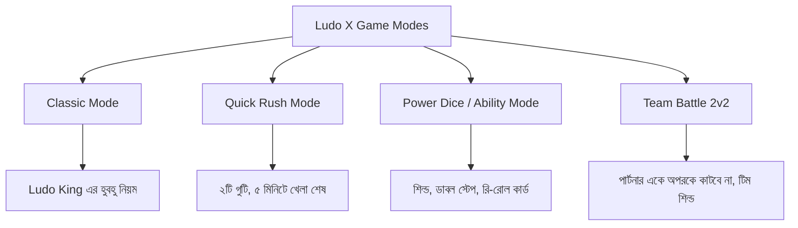
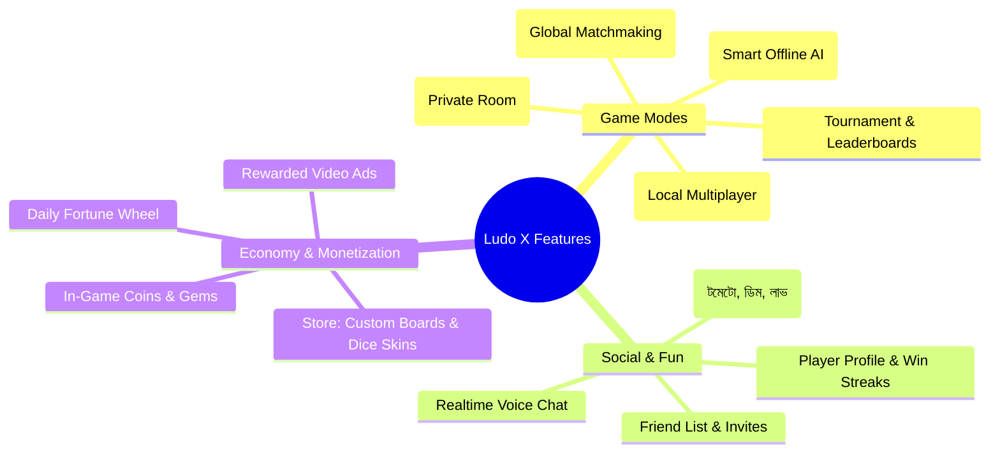
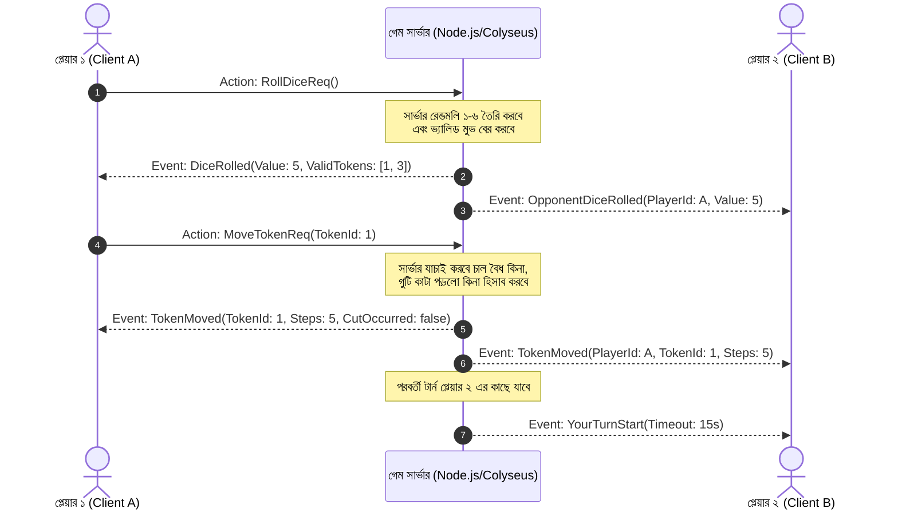
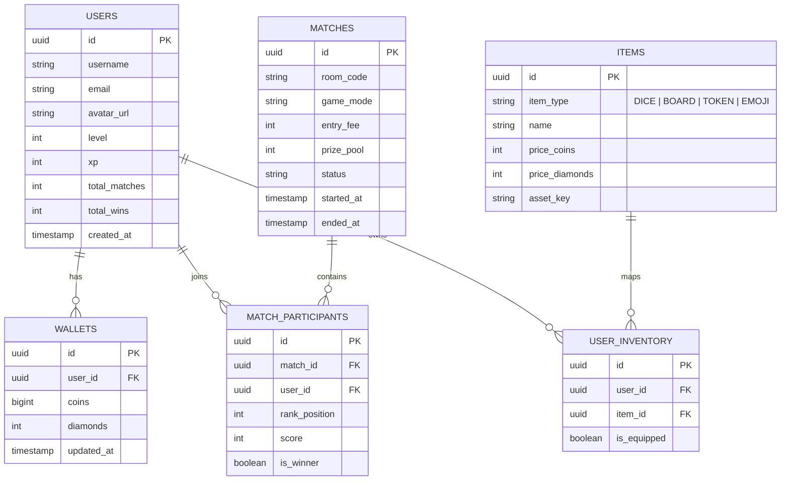
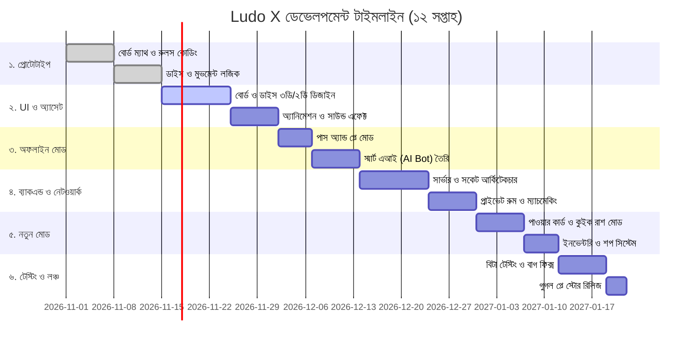

# 🎲 Ludo X (প্রজেক্ট ডিজাইন ও আর্কিটেকচার ডকুমেন্ট - Full GDD & SRS)

> **প্রজেক্টের নাম:** Ludo X (লুডু এক্স)  
> **ক্যাটাগরি:** ক্রস-প্ল্যাটফর্ম মাল্টিপ্লেয়ার বোর্ড গেম (Mobile & Web)  
> **অনুপ্রেরণা:** Ludo King (ক্লাসিক বোর্ড মেকানিক্স + নতুন ইনোভেটিভ নিয়মাবলী + আধুনিক ভিজ্যুয়াল ডিজাইন)  
> **টার্গেট প্ল্যাটফর্ম:** Android, iOS এবং Web  
> **ডকুমেন্ট ভার্সন:** 1.0.0  
> **তারিখ:** অক্টোবর ২০২৬  

---

## ১. প্রজেক্ট পরিচিতি ও ভিশন (Project Overview & Vision)

### ১.১ ভিশন স্টেটমেন্ট (Vision Statement)
প্লে স্টোরে থাকা "Ludo King" গেমটি সারা বিশ্বে তুমুল জনপ্রিয় হলেও এর ইউজার ইন্টারফেস (UI), গ্রাফিক্স এবং গেমপ্লের ধরণ অনেক বছর ধরে প্রায় একই রকম রয়েছে। 
আমাদের লক্ষ্য হলো এমন একটি গেম তৈরি করা যা:
1. **ক্লাসিক লুডু কিং-এর নিখুঁত নিয়মাবলী** বজায় রাখবে যাতে পুরোনো ও সাধারণ প্লেয়াররা সহজেই অভ্যস্ত হতে পারে।
2. **আধুনিক, নজরকাড়া এবং স্বতন্ত্র ভিজ্যুয়াল ডিজাইন** (যেমন: নিয়ন অ্যারেনা, রয়্যাল উডেন এস্টেট, মডার্ন থ্রিডি আইসোমেট্রিক থিম) উপহার দেবে।
3. **নতুন ও রোমাঞ্চকর কিছু স্পেশাল রুলস/মোড** (যেমন: পাওয়ার ডাইস, কুইক রাশ, সারপ্রাইজ টাইলস) যুক্ত করবে যা গেমটিকে বিরক্তিকর হওয়া থেকে বাঁচাবে এবং দ্রুতগতির করে তুলবে।

---

## ২. গেমের নিয়মাবলী (Game Rules & Mechanics)

গেমটিতে দুইটি প্রধান নিয়মের ক্যাটাগরি থাকবে:
1. **ক্লাসিক রুলস (Classic Ludo King Rules)**
2. **নতুন ইনোভেটিভ রুলস (New & Custom Game Modes)**



---

### ২.১ ক্লাসিক নিয়মাবলী (Classic Mode - Like Ludo King)

* **খেলোয়াড় সংখ্যা:** ২ থেকে ৪ জন (বা ৬ জনের এক্সটেনশন)।
* **প্রাথমিক অবস্থা:** প্রতিটি প্লেয়ারের রঙ (লাল, সবুজ, হলুদ, নীল) এবং তাদের ঘরে ৪টি করে গুটি (Tokens) থাকবে।
* **গুটি বের হওয়া:** ডাইসে **৬ (Six)** পড়লে বেস থেকে একটি গুটি স্টার্টিং পজিশনে বের করা যাবে।
* **মুভমেন্ট:** ডাইসের সংখ্যার ওপর ভিত্তি করে গুটি ক্লকওয়াইজ (ঘড়ির কাঁটার দিকে) ৫২টি ঘরের ট্র্যাকে ঘুরবে।
* **গুটি কাটা (Cutting/Elimination):** 
  * যদি কোনো প্লেয়ারের গুটি এমন ঘরে পৌঁছায় যেখানে প্রতিপক্ষের একটি গুটি রয়েছে, তবে প্রতিপক্ষের গুটিটি কাটা পড়বে এবং সেটি আবার বেস-এ ফিরে যাবে।
  * গুটি কাটলে খেলোয়াড় একটি **অতিরিক্ত চাল (Bonus Turn)** পাবে।
* **নিরাপদ ঘর (Safe Zones / Stars):**
  * বোর্ডের ৮টি নির্দিষ্ট ঘর নিরাপদ (যেমন স্টার চিহ্নিত ঘর ও স্টার্টিং ঘর)। এখানে কোনো গুটি কাটা যাবে না। একাধিক প্লেয়ারের গুটি একই নিরাপদ ঘরে একসাথে অবস্থান করতে পারবে।
* **টানা তিনবার ৬ (Consecutive Sixes Rule):** 
  * ডাইসে ৬ পড়লে প্লেয়ার চাল দেওয়ার পর আরেকটি চাল পায়।
  * কিন্তু যদি **টানা ৩ বার ৬** পড়ে, তবে ৩য় চালটি বাতিল (Invalid) হবে এবং টার্ন পরবর্তী প্লেয়ারের কাছে চলে যাবে।
* **হোম ট্রায়াঙ্গেল ও বিজয়:**
  * পুরো পথ ঘুরে নিজ রঙের হোম রো-তে ঢুকে সেন্টারে (Home Triangle) ৪টি গুটি আগে পৌঁছালে সেই প্লেয়ার ১ম (Winner) হবে।

---

### ২.২ নতুন ও উদ্ভাবনী নিয়মাবলী (New Innovative Rules & Modes)

খেলোয়াড়দের নতুন অভিজ্ঞতা দেওয়ার জন্য আমরা নিম্নলিখিত নতুন মেকানিক্স যুক্ত করছি:

#### ক) পাওয়ার ডাইস ও কার্ড মোড (Power Dice / Ability Mode)
বোর্ডে খেলার সময় প্লেয়াররা কিছু স্পেশাল কুলডাউন কার্ড বা পাওয়ার পাবে:
1. **শিল্ড কার্ড (Shield):** ১ রাউন্ডের জন্য নির্দিষ্ট কোনো গুটির ওপর একটি প্রোটেক্টিভ শিল্ড তৈরি হবে। ওই সময়ে কেউ এসে পড়লেও গুটি কাটা যাবে না।
2. **রি-রোল টিকিট (Re-roll):** ডাইসে কাঙ্ক্ষিত সংখ্যা না পড়লে প্রতি ম্যাচে সর্বোচ্চ ২ বার ডাইস পুনরায় রোল করা যাবে।
3. **স্পিড বুস্ট / ডাবল স্টেপ (Jump):** প্রতিপক্ষের গুটির উপর দিয়ে জাম্প করে ২ ঘর সামনে যাওয়ার বিশেষ ক্ষমতা।

#### খ) কুইক রাশ মোড (Quick Rush - 2 Tokens Only)
* অনেক সময় ২০-২৫ মিনিট ধরে লুডু খেলার সময় থাকে না।
* এই মোডে প্রতি প্লেয়ারের মাত্র **২টি গুটি** থাকবে।
* ডাইসে **১ অথবা ৬** পড়লেই গুটি বের হবে।
* ম্যাচ মাত্র ৩ থেকে ৫ মিনিটে শেষ হবে।

#### গ) রহস্যময় ঘর (Mystery / Surprise Tiles)
* ট্র্যাকে কয়েকটি ডাইনামিক ঘর থাকবে যা প্রতি ৫ রাউন্ড পরপর তাদের অবস্থান পরিবর্তন করে:
  * **গোল্ডেন টাইল (Coin Bonus):** এখানে পা রাখলে অতিরিক্ত ইন-গেম কয়েন বোনাস পাওয়া যাবে।
  * **শর্টকাট পোর্টাল (Warp Portal):** এই ঘরে পড়লে সরাসরি ৫ ঘর সামনে টেলিপোর্ট হবে।
  * **স্লিপার টাইল (Trap):** পরবর্তী রাউন্ডে ওই গুটির চাল ১ কদম কমে যাবে।

#### ঘ) ২ বনাম ২ টিম ব্যাটল (2v2 Team Clash)
* মুখোমুখি থাকা দুই প্লেয়ার হবে টিমমেট।
* টিমমেটরা একে অপরের গুটি কাটতে পারবে না।
* দুজন পার্টনারের গুটি একই ঘরে বসলে সেটি **'মেগা ব্লক'** তৈরি করবে, যা অন্য কোনো সাধারণ গুটি অতিক্রম করতে পারবে না।

---

## ৩. ভিজ্যুয়াল ডিজাইন ও UI/UX রূপরেখা (Distinct Visual & UI/UX Design)

Ludo King-এর পুরনো অ্যানালগ প্লাস্টিক বোর্ডের চেহারা থেকে বের হয়ে আমরা গেমটিতে দেব আধুনিক প্রিমিয়াম লুক:

```
+-----------------------------------------------------------------------+
|  🎨 Theme 1: Neon Cyber Arena (গাঢ় ব্যাকগ্রাউন্ডে নিয়ন গ্লোয়িং বোর্ড) |
|  🎨 Theme 2: Royal Heritage (মুঘল ও ভিন্টেজ উডেন কারুকাজ নকশা)        |
|  🎨 Theme 3: Modern 3D Glassmorphism (স্বচ্ছ কাঁচ ও মিনিমালিস্টিক স্টাইল) |
|  🎨 Theme 4: Deshi Canvas (গ্রামীন আলপনা ও উৎসবমুখর ঐতিহ্যবাহী লুক)  |
+-----------------------------------------------------------------------+
```

### ৩.১ ডিজাইন পার্থক্য (Ludo King vs Ludo X)
| ফিচার | সাধারণ লুডু কিং | লুডু এক্স (আমাদের ডিজাইন) |
| :--- | :--- | :--- |
| **বোর্ড স্টাইল** | ফ্ল্যাট ২ডি ব্রাইট কালার | ডেপথ-সহ আইসোমেট্রিক ২.৫ডি / হাইব্রিড ফ্লুইড ৩ডি |
| **গুটির রূপ** | সাধারণ প্লাস্টিক কোণ/পন | অ্যানিমেটেড থিমভিত্তিক ক্যারেক্টার / প্রিমিয়াম ৩ডি ক্রাউন টোকেন |
| **ডাইস রোল** | সাধারণ স্পিন অ্যানিমেশন | ফিজিক্স বেসড ৩ডি রোলিং, হ্যাপ্টিক ভাইব্রেশন ও স্পার্কল এফেক্ট |
| **সাউন্ড ডিজাইন** | গতানুগতিক ক্লটার সাউন্ড | স্যাটিসফায়িং ASMR সাউন্ড, ডাইস থাম্প এবং জয়ের সেলিব্রেশন মিউজিক |
| **রুম ও লবি** | জটিল এবং বিজ্ঞাপনে ভরা মেনু | পরিচ্ছন্ন, মডার্ন কার্ড-বেসড নেভিগেশন ও নো-ক্ল্যাটার UI |

---

## ৪. গেম মোড ও ফিচারসমূহ (Game Modes & Features)



### ৪.১ প্লে উইথ ফ্রেন্ডস (Private Room)
* প্লেয়ার একটি ৬ সংখ্যার প্রাইভেট রুম কোড জেনারেট করবে।
* WhatsApp, Messenger বা সরাসরি শেয়ারের মাধ্যমে বন্ধুদের ইনভাইট করে খেলা যাবে।
* রুম ক্রিয়েটর গেমের নিয়ম (যেমন: ক্লাসিক নাকি পাওয়ার মোড) নির্ধারণ করতে পারবে।

### ৪.২ অনলাইন মাল্টিপ্লেয়ার ও ম্যাচমেকিং (Online Matchmaking)
* র‍্যাঙ্ক-বেসড ইলো (ELO) সিস্টেম।
* প্লেয়ারের লেভেল অনুযায়ী সমমানের প্রতিপক্ষের সাথে ৫-১০ সেকেন্ডের মধ্যে অটো-ম্যাচ।

### ৪.৩ অফলাইন বনাম কম্পিউটার (Smart AI)
* ইন্টারনেট না থাকলেও খেলা যাবে।
* ৩টি ভিন্ন এআই ডিফিকাল্টি লেভেল:
  * **ইজি (Casual):** সাধারণ চাল।
  * **মিডিয়াম (Balanced):** গুটি কাটার সুযোগ খোঁজে।
  * **হার্ড (Competitive):** সেফ জোনের হিসাব রাখে, ডাইসের সম্ভাব্য দূরত্বের প্রোবাবিলিটি হিসেব করে চাল দেয়।

### ৪.৪ সোশ্যাল ও বিনোদন ফিচার
* খেলার মাঝে ফানি অ্যানিমেটেড ইমোজি ছোঁড়া (যেমন: প্রতিপক্ষ ৬ পেলে বা গুটি কাটলে টমেটো বা ডিম ছোঁড়া, তালি দেওয়া)।
* কুইক চ্যাট মেসেজ ("দেরি করিস না!", "এবার কিন্তু তোরে ধরবো!", "খেলা হবে!")।
* বন্ধুদের সাথে লাইভ অডিও চ্যাটের সুবিধা (ঐচ্ছিক)।

---

## ৫. সিস্টেম আর্কিটেকচার ও টেকনিক্যাল স্ট্যাক (Technical Architecture & Stack)

প্রজেক্টটির দীর্ঘমেয়াদী পারফর্ম্যান্স ও বড় ইউজার বেস হ্যান্ডেল করার জন্য প্রস্তাবিত প্রযুক্তি কাঠামো:

### ৫.১ প্রস্তাবিত টেক স্ট্যাক (Recommended Tech Stack)

| স্তর (Layer) | প্রস্তাবিত প্রযুক্তি | বিকল্প পছন্দ | নির্বাচনের কারণ |
| :--- | :--- | :--- | :--- |
| **Game Engine (Front-end)** | **Unity (C#)** | **Flutter (Flame Engine)** | • Unity: 3D/2D হাই-পারফরম্যান্স গ্রাফিক্স ও ফিজিক্সের জন্য ইন্ডাস্ট্রি সেরা।<br>• Flutter: অত্যন্ত লাইটওয়েট (~15-20MB অ্যাপ সাইজ) ও দ্রুত 2D বোর্ড গেম তৈরির জন্য দারুণ। |
| **Multiplayer Server** | **Node.js (TypeScript) + Colyseus / Socket.io** | **Go (Golang) / Nakama** | রিয়েলটাইম লো-লেটেন্সি স্টেট সিঙ্ক্রোনাইজেশন এবং রুম ম্যানেজমেন্টের জন্য সেরা। |
| **In-Memory Cache & Session** | **Redis** | **KeyDB** | প্রতিটি চলমান ম্যাচের স্টেট দ্রুত মেমরিতে রাখা এবং ফাস্ট ম্যাচমেকিং। |
| **Database** | **PostgreSQL** + Prisma ORM | **MongoDB** | ইউজার প্রোফাইল, কয়েন ট্রানজ্যাকশন, ইনভেন্টরি ও লিডারবোর্ডের সিকিউর ডেটা ম্যানেজমেন্ট। |
| **Authentication** | **Firebase Auth** / Custom JWT | **Supabase** | গুগল লগইন, ফেসবুক লগইন ও ফোন নম্বর ওটিপি। |
| **Cloud Infrastructure** | **Docker + AWS (EC2/ECS)** | **DigitalOcean / Railway** | স্কেলেবল সার্ভার হোস্টিং। |

---

### ৫.২ মাল্টিপ্লেয়ার কমিউনিকেশন আর্কিটেকচার (Networking Flow)

লুডু গেমে ক্লায়েন্ট সাইডে কোনো ডিসিশন রাখা যাবে না (হ্যাক রোধ করার জন্য)। **Authoritative Server Architecture** ব্যবহার করতে হবে:



> ⚠️ **অ্যান্টি-চিট নিয়ম (Anti-Cheat & RNG Security):**  
> ডাইসের মান কখনোই মোবাইল ফোনে তৈরি হবে না। সার্ভারে ক্রিপ্টোগ্রাফিকালি সিকিউর র‍্যান্ডম নাম্বার জেনারেটর (CSPRNG) দিয়ে ডাইস রোল তৈরি হবে। ফলে কোনো থার্ড পার্টি অ্যাপ বা হ্যাক দিয়ে ৬ ফেলা সম্ভব হবে না।

---

## ৬. ডেটাবেস স্কিমা ডিজাইন (Database Schema)

নিচে ইউজার এবং গেম সিস্টেমের জন্য প্রয়োজনীয় ডেটাবেস টেবিলগুলোর রিলেশন দেখানো হলো:



---

## ৭. বোর্ড ম্যাথমেটিক্স ও কোঅর্ডিনেট সিস্টেম (Board Math & Logic)

একটি স্ট্যান্ডার্ড লুডু বোর্ডে মোট **৫২টি সাধারণ ঘর** থাকে এবং প্রতিটি রঙের জন্য **৫টি হোম-রান ঘর** ও **১টি ফাইনাল হোম ট্রায়াঙ্গেল** থাকে।

```
  [Green Home]   |   Track 11 - 17   |   [Yellow Home]
  ---------------+-------------------+----------------
  Track 45 - 51  |  [Home Triangle]  |   Track 18 - 24
  ---------------+-------------------+----------------
  [Red Home]     |   Track 38 - 32   |   [Blue Home]
```

* **টোটাল কমন পাথ ইন্ডেক্স:** `0` থেকে `51`
* **রঙ অনুযায়ী স্টার্টিং পয়েন্ট:**
  * লাল (Red): Index `0`
  * সবুজ (Green): Index `13`
  * হলুদ (Yellow): Index `26`
  * নীল (Blue): Index `39`
* **হোম এন্ট্রান্স (Home Entry):**
  * লাল রঙের গুটি ৫১ ঘর ঘোরার পর ইণ্ডেক্স ৫০ দিয়ে রেড হোম-পাথে প্রবেশ করবে।
* **গুটি কাটার সমীকরণ (Collision Check Formula):**
  $$\text{TargetIndex} = (\text{CurrentIndex} + \text{DiceRoll}) \pmod{52}$$
  যদি $\text{TargetIndex}$ কোনো সেফ জোন (Star Index: $0, 8, 13, 21, 26, 34, 39, 47$) না হয় এবং সেখানে অন্য প্লেয়ারের গুটি থাকে, তবে:
  $$\text{Kill}(\text{OpponentToken}) \rightarrow \text{Reset to Base} + \text{Grant Bonus Turn}$$

---

## ৮. মনিটাইজেশন স্ট্র্যাটেজি (Monetization Strategy)

গেমটি থেকে রাজস্ব আয়ের জন্য একটি ব্যালেন্সড ও ইউজার-ফ্রেন্ডলি মডেল:

1. **পুরস্কৃত ভিডিও বিজ্ঞাপন (Rewarded Ads):**
   * ডাইস রি-রোল করতে চাইলে ছোট ৫-১৫ সেকেন্ডের বিজ্ঞাপন দেখা।
   * ম্যাচ হারার পর কয়েন শেষ হয়ে গেলে ভিডিও অ্যাড দেখে ফ্রি কয়েন সংগ্রহ।
2. **ইন-অ্যাপ পারচেস (In-App Purchases - IAP):**
   * বিশেষ ডাইস স্কিন (যেমন: ফায়ার ডাইস, গোল্ডেন ড্রাগন ডাইস)।
   * প্রিমিয়াম বোর্ড থিম (রয়েল নিয়ন থিম, গ্লাস থিম)।
   * কয়েন ও ডায়মন্ড প্যাক (গুগল প্লে স্টোর ও লোকাল পেমেন্ট গেটওয়ে সাপোর্ট)।
3. **ব্যাটল পাস / ভিআইপি মেম্বারশিপ (VIP Club):**
   * বিজ্ঞাপনমুক্ত এক্সপেরিয়েন্স।
   * এক্সক্লুসিভ ব্যাজ এবং প্রিমিয়াম ইমোজি প্যাক।

---

## ৯. ডেভেলপমেন্ট রোডম্যাপ ও অ্যাকশন প্ল্যান (Implementation Roadmap)

প্রজেক্টটি শুরু থেকে গুগল প্লে স্টোরে রিলিজ পর্যন্ত মোট ৬টি ধাপে সম্পন্ন হবে:



---

## ১০. পরবর্তী বাস্তবায়ন পদক্ষেপ (Immediate Next Steps)

এখন কাজ শুরু করার জন্য প্রাথমিক তিনটি সিদ্ধান্ত প্রয়োজন:
1. **ইঞ্জিন নির্বাচন:** আপনি কি **Unity (C#)** দিয়ে গেমটি বানাতে চান (যা ইন্ডাস্ট্রি স্ট্যান্ডার্ড ও বেশি রিচ গ্রাফিক্স দেয়) নাকি **Flutter (Flame/Canvas)** দিয়ে শুরু করতে চান (যা হালকা ও সহজে মেইনটেইন করা যায়)?
2. **ডিজাইন থিম পছন্দ:** আপনার পছন্দের প্রাথমিক থিম কোনটি? (নিয়ন সাইবার নাকি রয়্যাল উডেন নাকি দেশি ক্যানভাস?)
3. **কাজের সূচনা:** 
   * ধাপ-১: আমরা প্রথমে সম্পূর্ণ গেম ম্যাথমেটিক্স ও মুভমেন্ট লজিকের স্ক্রিপ্ট তৈরি করতে পারি।
   * ধাপ-২: এরপর ইন্টারফেস বা সার্ভারের কাজ শুরু করা যাবে।
